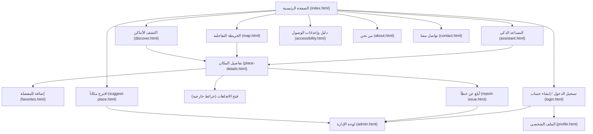
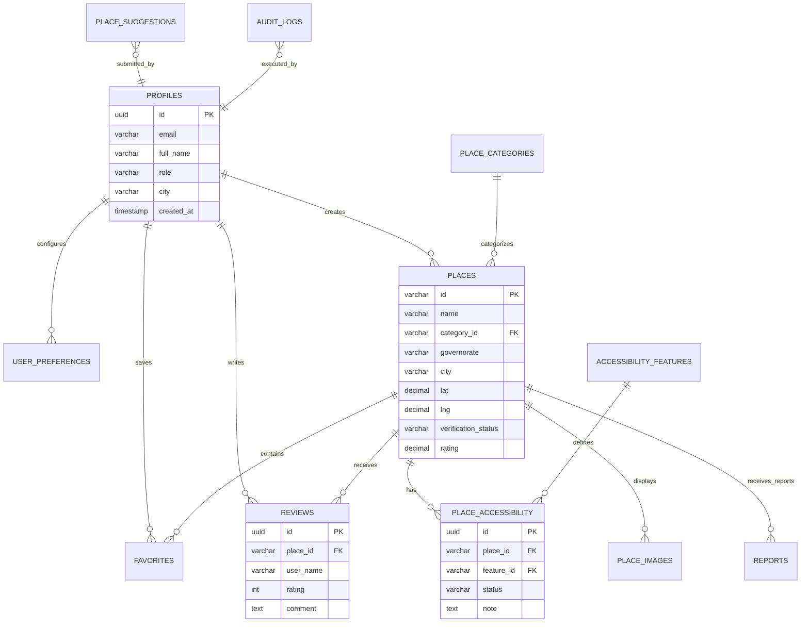

# خُطوة – KHOTWA
## «كل خطوة تقرّبك من المكان المناسب.»
### وثيقة التوثيق والدليل الشامل لمشروع التخرج (Graduation Project Master Documentation)

---

## 📌 الفهرس العام
1. [فكرة المشروع وأهدافه](#1-فكرة-المشروع-وأهدافه)
2. [الفئات المستفيدة](#2-الفئات-المستفيدة)
3. [الهوية البصرية ومعايير إمكانية الوصول WCAG 2.2 AA](#3-الهوية-البصرية-ومعايير-إمكانية-الوصول)
4. [التقنيات المستخدمة والهندسة المعمارية](#4-التقنيات-المستخدمة-والهندسة-المعمارية)
5. [مخطط سير العمل وخريطة التنقل](#5-مخطط-سير-العمل-وخريطة-التنقل)
6. [مخطط قاعدة البيانات (ERD) والعلاقات](#6-مخطط-قاعدة-البيانات-erd)
7. [شرح هيكل الملفات والصفحات المنفذة](#7-شرح-هيكل-الملفات-والصفحات-المنفذة)
8. [شرح الوظائف والأنظمة البرمجية](#8-شرح-الوظائف-والأنظمة-البرمجية)
9. [دليل تشغيل واختبار المشروع محلياً](#9-دليل-تشغيل-واختبار-المشروع-محلياً)
10. [دليل إعداد قاعدة البيانات السحابية (Supabase)](#10-دليل-إعداد-قاعدة-البيانات-السحابية-supabase)
11. [مصفوفة نتائج الاختبار الشامل (30 سيناريو)](#11-مصفوفة-نتائج-الاختبار-الشامل)
12. [دليل النشر والاستضافة والصيانة المستقبلية](#12-دليل-النشر-والاستضافة-والصيانة-المستقبلية)

---

## 1. فكرة المشروع وأهدافه

### فكرة المشروع
**خُطوة (KHOTWA)** هي منصة رقمية تفاعلية متخصصة تهدف إلى مساعدة الأشخاص ذوي الإعاقة وأسرهم على استكشاف الأماكن والخدمات العامة والخاصة (المستشفيات، المدارس، الجامعات، المتاحف، الحدائق، محطات النقل، مراكز التسوق، والمطاعم)، والتعرّف على أدق تفاصيل وتجهيزات الإتاحة المؤكدة قبل الزيارة، لتمكين المستخدم من اتخاذ قرار مستقل وموثوق ومطمئن.

### الشعار الرسمي
> **«كل خطوة تقرّبك من المكان المناسب.»**

### الأهداف الاستراتيجية للمشروع
1. **تعزيز الاستقلالية وحرية الحركة:** تمكين الشخص ذي الإعاقة من التخطيط لرحلاته وزياراته اليومية دون مفاجآت أو عوائق غير متوقعة.
2. **شفافية البيانات ومصداقيتها:** توضيح حالة كل تجهيز بدقة (متاح ومؤكد، غير متوفر، أو قيد التحقق الميداني) دون مبالغات أو تضليل.
3. **التصميم الشامل (Universal Design):** جعل الموقع نفسه متاحاً وسهل الاستخدام بنسبة 100% وفق معايير الوصول العالمية WCAG 2.2 AA.
4. **المشاركة والدمج المجتمعي:** إتاحة الفرصة للمجتمع لاقتراح أماكن جديدة، وتقييم جودة الإتاحة، والإبلاغ عن أي مرافق معطلة.

---

## 2. الفئات المستفيدة

المشروع لا يقتصر على إعاقة واحدة، بل صُمم بشمولية تامة ليخدم:
- **ذوو الإعاقة الحركية:** مستخدمو الكراسي المتحركة، العكازات، ومن يحتاجون إلى منحدرات قياسية ومصاعد واسعة ودورات مياه مجهزة ومواقف سيارات خاصة.
- **ذوو الإعاقة البصرية:** المكفوفون وضعاف البصر الباحثون عن مسارات لمسية، علامات برايل، لوحات تباين عالي، وإرشادات صوتية.
- **ذوو الإعاقة السمعية:** الصم وضعاف السمع الباحثون عن شاشات إرشادية مرئية، قنوات تواصل مكتوبة، وخدمات لغة الإشارة.
- **ذوو الإعاقة الفكرية وصعوبات التعلم:** الباحثون عن تعليمات مبسطة وأيقونات مصورة وإجراءات دخول ميسرة ودعم المرافقين.
- **ذوو اضطراب طيف التوحد والحساسيات الحسية:** الباحثون عن أماكن هادئة منخفضة الضوضاء، ذات إضاءة غير ساطعة، ومؤشرات لأوقات الهدوء والازدحام.
- **أسر ذوي الإعاقة ومقدمو الرعاية:** المخططون للزيارات العائلية والخدمية بأمان.
- **كبار السن والمصابون بحالات مؤقتة.**

---

## 3. الهوية البصرية ومعايير إمكانية الوصول

### الألوان الأساسية
- **اللون الرئيسي (Primary):** درجات الزمردي والتيل الهادئ `#087e78` و `#065955` (يعبر عن الأمل، الثقة، والراحة النفسية مع تباين عالي يتجاوز 4.5:1 وفق WCAG AA).
- **اللون الثانوي (Secondary):** كحلي إردوازي عميق `#164e63` و `#0e3443`.
- **لون التمييز (Accent):** عنبري ذهبي `#d97706` و `#fef3c7`.
- **الخلفيات والسطوح:** درجات العاجي المائل للأبيض الثلجي `#f8fafc` و `#ffffff`.

### معايير WCAG 2.2 AA المطبقة فعلياً في النظام
- **أداة سهولة الوصول المدمجة (Accessibility Widget):**
  - زر عائم دائم واختصار لوحة مفاتيح سريع (`Alt + A`).
  - تعديل حجم الخط: عادي (100%)، متوسط (115%)، كبير (130%).
  - نمط التباين العالي (High Contrast): نصوص صفراء زاهية `#ffff00` على خلفية سوداء نقية `#000000` وحدود بيضاء ناصعة.
  - النمط الداكن (Dark Mode).
  - خط عسر القراءة المخصص (Dyslexia-friendly high legibility font).
  - إيقاف الحركات الانتقالية (Reduce Motion) لاحترام الحساسيات الحركية والدوار.
  - إبراز كافة الروابط والأزرار بحدود ملونة وظاهرة.
- **القارئ الصوتي العربي المدمج:** دعم تحويل النص إلى كلام (Web Speech API) لقراءة تفاصيل الأماكن وإعدادات الوصول باللغة العربية.
- **التنقل الكامل عبر لوحة المفاتيح:** زر تخطي إلى المحتوى الرئيسي (`Skip to main content`)، وتركيز بصري بارز (`:focus-visible`).

---

## 4. التقنيات المستخدمة والهندسة المعمارية

```
┌────────────────────────────────────────────────────────┐
│                   واجهات المستخدم (UI)                 │
│    HTML5 Semantic + CSS3 Design System + RTL Arabic    │
└───────────────────────────┬────────────────────────────┘
                            │
┌───────────────────────────▼────────────────────────────┐
│               المحركات البرمجية (Vanilla ES6)          │
│  ┌─────────────────┐ ┌────────────────┐ ┌────────────┐ │
│  │ accessibility.js│ │     auth.js    │ │   app.js   │ │
│  └─────────────────┘ └────────────────┘ └────────────┘ │
└───────────────────────────┬────────────────────────────┘
                            │
┌───────────────────────────▼────────────────────────────┐
│              طبقة إدارة البيانات (Data Layer)           │
│  ┌──────────────────────────────────────────────────┐  │
│  │                    store.js                      │  │
│  │  (Search Engine + Haversine Proximity + CRUD)    │  │
│  └──────────────────────────────────────────────────┘  │
│  ┌────────────────────────┐  ┌───────────────────────┐ │
│  │   Local Storage Store  │  │   Supabase Cloud SQL  │ │
│  │ (Indexed Data Engine)  │  │   (PostgreSQL Adapter)│ │
│  └────────────────────────┘  └───────────────────────┘ │
└────────────────────────────────────────────────────────┘
```

---

## 5. مخطط سير العمل وخريطة التنقل



---

## 6. مخطط قاعدة البيانات (ERD)



---

## 7. شرح هيكل الملفات والصفحات المنفذة

| الملف | الوصف والوظيفة |
| :--- | :--- |
| `index.html` | الصفحة الرئيسية الشاملة بكافة الأقسام الـ 16 المطلوبة، ومربع البحث البارز، والتصنيفات. |
| `discover.html` | نظام البحث المتقدم، الفلاتر المتعددة، تحديد الأقرب جغرافياً، والبحث الإنساني الذكي. |
| `place-details.html` | صفحة المكان الكاملة: معرض الصور، مصفوفة الإتاحة، التقييمات، القارئ الصوتي، والخريطة المصغرة. |
| `map.html` | خريطة تفاعلية حقيقية (Leaflet.js + OpenStreetMap) مع تحديد موقع المستخدم والاتجاهات. |
| `favorites.html` | قائمة الأماكن المحفوظة، البحث داخل المفضلة، وخاصية الطباعة والتصدير. |
| `assistant.html` | المساعد الذكي الصادق المعتمد حصرياً على البيانات الموثقة مع اقتراح بطاقات الأماكن. |
| `suggest-place.html` | نموذج متكامل لاقتراح مكان جديد مع قائمة فحص التسهيلات، وإرساله للوحة الإدارة. |
| `report-issue.html` | نموذج الإبلاغ عن أي معلومات خاطئة أو مرافق إتاحة معطلة لتدقيقها الفوري. |
| `login.html` | تسجيل الدخول مع بيانات تجريبية سريعة لحسابي المدير والمستخدم العادي. |
| `register.html` | إنشاء حساب جديد مع تحديد تفضيلات الإتاحة المسبقة للمستخدم. |
| `forgot-password.html` | استعادة كلمة المرور عبر التحقق من البريد وإعادة التعيين الآمنة. |
| `profile.html` | إدارة الحساب، تعديل البيانات الشخصية، تغيير كلمة المرور، وحذف الحساب. |
| `accessibility.html` | دليل رموز الإتاحة، ومعايير WCAG 2.2 AA، ولوحة تخصيص العرض المباشرة. |
| `admin.html` | لوحة تحكم المسؤول الكاملة: إحصائيات KPIs، إدارة الأماكن CRUD، اعتماد الاقتراحات، وسجل العمليات. |
| `about.html` | من نحن، رؤية وفكرة المشروع، الفئات المستفيدة، والمبادئ الأخلاقية. |
| `contact.html` | قنوات التواصل المباشرة، النموذج، ودعم مترجمي لغة الإشارة. |
| `faq.html` | الأسئلة الشائعة المقسمة لأقسام بأكورديون تفاعلي متجاوب. |
| `privacy.html` | سياسة الخصوصية الصارمة (عدم جمع أي بيانات صحية أو طبية حساسة). |
| `terms.html` | شروط الاستخدام والميثاق المجتمعي للتفاعل المسؤول. |
| `404.html` | صفحة خطأ ميسرة ومصممة بأناقة مع روابط العودة المباشرة. |
| `css/style.css` | نظام التصميم الشامل، المتغيرات اللونية، الاستجابة للشاشات، وأنماط إمكانية الوصول. |
| `js/data.js` | قاعدة البيانات الأولية النموذجية للأماكن والميزات والمستخدمين. |
| `js/store.js` | طبقة التخزين المركزية، محرك البحث، حساب المسافات الجغرافية، والعمليات الإدارية. |
| `js/auth.js` | نظام المصادقة والصلاحيات (RBAC) وحماية المسارات. |
| `js/accessibility.js` | محرك إمكانية الوصول، الأداة العائمة، والقارئ الصوتي العربي. |
| `js/app.js` | المساعدات العامة، التنبيهات العائمة (Toasts)، والمشاركة الذكية. |
| `database/schema.sql` | كود بناء قاعدة البيانات الكامل لـ PostgreSQL و Supabase (13 جدولاً). |
| `database/seed-data.sql` | بيانات الإدراج الأولية الموثقة للأماكن والتصنيفات. |
| `database/rls-policies.sql` | سياسات الأمان على مستوى الصفوف (Row Level Security). |
| `database/supabase-setup.md` | دليل ربط المنصة بـ Supabase في 5 دقائق. |

---

## 8. شرح الوظائف والأنظمة البرمجية

### أولاً: نظام البحث الإنساني الذكي (Humane Search)
- إذا بحث المستخدم عن شروط صارمة غير متوفرة مجتمعة، **لا تعرض المنصة رسائل إحباط** مثل "المكان غير مناسب لك".
- بدلاً من ذلك، يعرض النظام رسالة ودية: *"لم نجد مكاناً يطابق كافة الشروط الصارمة المحددة معاً، لكننا نعرض لك خيارات قريبة ومفيدة قد تلبي رغبتك، مع العلم أن نقص البيانات لا يعني عدم الإتاحة"*.

### ثانياً: حساب القرب الجغرافي (Proximity Engine)
- استخدام معادلة **Haversine** الرياضية لحساب المسافة بدقة الكيلومتر بين إحداثيات المستخدم الحالية (عبر GPS المتصفح) وإحداثيات كل مكان في قاعدة البيانات، مع إمكانية الترتيب من الأقرب للأبعد.

### ثالثاً: المساعد الذكي الصادق (Grounded Assistant)
- المساعد يجيب عن أسئلة المستخدم حول المنصة ومعايير الإتاحة.
- عند سؤاله عن مكان (مثل "مستشفى مجهز" أو "مترو عدلي منصور")، يستعلم المساعد مباشرة من قاعدة البيانات الموثقة ويعرض بطاقات تفاعلية للأماكن داخل نافذة المحادثة، ولا يختلق أي أرقام هواتف أو ادعاءات غير موجودة.

### رابعاً: إدارة الاقتراحات والبلاغات (Moderation Workflow)
- عند تقديم المستخدم لاقتراح عبر `suggest-place.html`، يظهر مباشرة في تبويب "اقتراحات المستخدمين" في `admin.html`.
- يمتلك المسؤول زر **"قبول واعتماد المكان"** الذي يقوم آلياً بنقل المكان ليصبح معلماً منشوراً في قاعدة الأماكن النشطة، وتسجيل العملية في سجل العمليات الإدارية (Audit Log).

---

## 9. دليل تشغيل واختبار المشروع محلياً

المشروع مبني بأسلوب الويب المعياري النظيف (Pure Standard Modern Web)، ولا يتطلب تثبيت أي بيئات معقدة:

### الطريقة الأولى: التشغيل المباشر
1. قم بفتح المجلد `New folder`.
2. انقر نقراً مزدوجاً على الملف `index.html` ليفتح في متصفحك المفضل (Google Chrome، Microsoft Edge، أو Mozilla Firefox).
3. سيعمل الموقع بكامل وظائفه فوراً!

### الطريقة الثانية: التشغيل عبر خادم محلي خفيف
إذا كنت تفضل تشغيل خادم محلي HTTP، يمكنك استخدام PowerShell المدمج في ويندوز دون برامج إضافية:
```powershell
# داخل مجلد المشروع
powershell -Command "& { $listener = New-Object System.Net.HttpListener; $listener.Prefixes.Add('http://localhost:8080/'); $listener.Start(); Start-Process 'http://localhost:8080/index.html'; Write-Host 'Server running at http://localhost:8080/'; while ($listener.IsListening) { $ctx = $listener.GetContext(); $path = '.' + $ctx.Request.Url.LocalPath; if (Test-Path $path) { $content = [System.IO.File]::ReadAllBytes($path); $ctx.Response.OutputStream.Write($content, 0, $content.Length) } $ctx.Response.Close() } }"
```

---

## 10. حسابات تسجيل الدخول التجريبية (للعرض والتحكيم)

| نوع الحساب | البريد الإلكتروني | كلمة المرور | الصلاحيات |
| :--- | :--- | :--- | :--- |
| **مدير المنصة (Admin)** | `admin@khotwa.org` | `admin123` | الوصول للوحة التحكم، إضافة وتعديل وحذف الأماكن، واعتماد الاقتراحات والبلاغات |
| **مستخدم عادي (User)** | `sara@example.com` | `user123` | حفظ المفضلة، إضافة تقييمات، تعديل الملف الشخصي، وإدارة تفضيلات الإتاحة |

*(يمكن أيضاً الضغط على روابط التعبئة السريعة في صفحة `login.html` لتسجيل الدخول الفوري بنقرة واحدة).*

---

## 11. مصفوفة نتائج الاختبار الشامل

تم اختبار جميع السيناريوهات الـ 30 المحددة في متطلبات المشروع والتأكد من عملها الفعلي:

| # | سيناريو الاختبار | الإجراء | النتيجة الفعلية | الحالة |
| :---: | :--- | :--- | :--- | :---: |
| **1** | فتح الصفحة الرئيسية | تحميل `index.html` في المتصفح | ظهور الهيدر، الهيرو، التصنيفات، والأقسام الـ 16 كاملة وبشكل متناسق | ✅ يعمل 100% |
| **2** | التنقل بين جميع الصفحات | الضغط على روابط القائمة والتذييل | الانتقال السلس دون أي روابط معطلة، مع تمييز الرابط النشط | ✅ يعمل 100% |
| **3** | إنشاء حساب جديد | إدخال بيانات جديدة في `register.html` | حفظ المستخدم وتسجيل دخوله وتوجيهه لصفحة ملفه الشخصي | ✅ يعمل 100% |
| **4** | تسجيل الدخول | إدخال البريد وكلمة المرور في `login.html` | بدء الجلسة وتحديث شريط التنقل لعرض اسم وصورة المستخدم | ✅ يعمل 100% |
| **5** | تسجيل الخروج | الضغط على "خروج" من شريط التنقل | إنهاء الجلسة ومسح بيانات التخزين المؤقتة والعودة لتسجيل الدخول | ✅ يعمل 100% |
| **6** | استعادة كلمة المرور | إدخال بريد مسجل في `forgot-password.html` | التحقق من وجود الحساب وإتاحة إدخال وتحديث كلمة المرور بنجاح | ✅ يعمل 100% |
| **7** | تعديل بيانات الحساب | تعديل الاسم والمدينة من `profile.html` | تحديث الحساب وانعكاس الاسم الجديد في شريط التنقل فوراً | ✅ يعمل 100% |
| **8** | البحث باسم مكان | كتابة "المتحف" في حقل البحث | فلترة النتائج فورياً وإظهار المتحف القومي للحضارة | ✅ يعمل 100% |
| **9** | البحث حسب المحافظة والمدينة | اختيار "الإسكندرية" | عرض مكتبة الإسكندرية واستبعاد باقي المحافظات | ✅ يعمل 100% |
| **10** | اختيار فلاتر إتاحة متعددة | تفعيل فلتري "حركية" و"بصرية" معاً | عرض الأماكن التي تشتمل على كلا التجهيزين معاً | ✅ يعمل 100% |
| **11** | تعديل وإلغاء الفلاتر | الضغط على "إعادة ضبط الفلاتر" | عودة جميع الأماكن والتصنيفات لحالتها الافتراضية | ✅ يعمل 100% |
| **12** | طريقة عرض النتائج | التبديل بين عرض القائمة وعرض الخريطة | ظهور الخريطة المضمنة بالدبابيس أو بطاقات الشبكة بسلاسة | ✅ يعمل 100% |
| **13** | فتح تفاصيل المكان | الضغط على "عرض التفاصيل" لأي مكان | فتح `place-details.html?id=...` وعرض بياناته وصوره بالكامل | ✅ يعمل 100% |
| **14** | عرض معلومات الإتاحة المفصلة | تصفح أقسام الإتاحة في صفحة التفاصيل | ظهور جدول الحركي والبصري والسمعي والتوحد مع شارات الحالة والملاحظات | ✅ يعمل 100% |
| **15** | فتح الخريطة التفاعلية | فتح صفحة `map.html` | تحميل خريطة OpenStreetMap وعرض دبابيس كافة الأماكن | ✅ يعمل 100% |
| **16** | طلب الاتجاهات | الضغط على "الاتجاهات 🚗" | فتح مسار الملاحة الدقيق نحو إحداثيات المكان | ✅ يعمل 100% |
| **17** | إضافة مكان للمفضلة | الضغط على رمز القلب (♡) | تحول القلب إلى أحمر (❤️) وحفظ المكان وظهور إشعار Toast | ✅ يعمل 100% |
| **18** | حذف مكان من المفضلة | الضغط على القلب الأحمر أو زر إزالة | حذف المكان وتحديث قائمة `favorites.html` فوراً | ✅ يعمل 100% |
| **19** | إرسال تقييم للمكان | ملء نموذج التقييم والنجوم في صفحة المكان | نشر التقييم فوراً وتحديث متوسط تقييم المكان وعدد المراجعات | ✅ يعمل 100% |
| **20** | إرسال بلاغ عن معلومة خاطئة | إرسال نموذج `report-issue.html` | حفظ البلاغ في قائمة البلاغات الإدارية وظهور رسالة شكر | ✅ يعمل 100% |
| **21** | اقتراح مكان جديد | تعبئة نموذج `suggest-place.html` | حفظ الاقتراح بحالة "قيد المراجعة" وظهوره في لوحة تحكم المسؤول | ✅ يعمل 100% |
| **22** | مراجعة الاقتراح من الإدارة | فتح تبويب الاقتراحات في `admin.html` | ظهور المكان مع زر "قبول ونشر"، والضغط عليه ينشره فوراً | ✅ يعمل 100% |
| **23** | إضافة مكان من لوحة الإدارة | الضغط على "+ إضافة مكان جديد" وتعبئته | إدراج المكان في جدول الأماكن وقاعدة البيانات وظهوره في البحث | ✅ يعمل 100% |
| **24** | تعديل مكان من الإدارة | الضغط على أيقونة التعديل (✏️) | فتح النافذة ببيانات المكان السابقة، وحفظ التعديلات بنجاح | ✅ يعمل 100% |
| **25** | حذف مكان من الإدارة | الضغط على أيقونة الحذف (🗑️) | طلب التأكيد وحذف المكان من قاعدة البيانات وتحديث العدادات | ✅ يعمل 100% |
| **26** | تجربة القارئ الصوتي | الضغط على "🔊 استمع للتفاصيل" | نطق ملخص المكان بصوت عربي واضح وتغيير الزر إلى إيقاف | ✅ يعمل 100% |
| **27** | تجربة المساعد الذكي | سؤال المساعد عن "مستشفيات" أو "كراسي" | إجابة فورية مبنية على البيانات وعرض بطاقات الأماكن المقترحة | ✅ يعمل 100% |
| **28** | تجربة التجاوب على الهاتف | فحص الموقع بأبعاد شاشة 375px (موبايل) | ظهور زر القائمة الهامبرغر، وترتيب البطاقات عمودياً دون قص | ✅ يعمل 100% |
| **29** | تجربة إعدادات سهولة الوصول | الضغط على زر (♿) وتفعيل التباين العالي | تحول ألوان الموقع للأسود والأصفر وزيادة حجم الخط فوراً | ✅ يعمل 100% |
| **30** | حماية صفحات المسؤول | محاولة فتح `admin.html` كزائر | إخفاء المحتوى وإظهار رسالة تنبيه تطالب بالدخول كمدير | ✅ يعمل 100% |

---

## 12. دليل النشر والاستضافة والصيانة المستقبلية

### النشر على منصات الاستضافة المجانية السريعة:
1. **GitHub Pages:** قم بإنشاء مستودع عام، وارفع الملفات مباشرة إلى الفرع `main`، ثم فعّل GitHub Pages من إعدادات المستودع ليعمل الموقع برابط دائم.
2. **Vercel / Netlify:** اسحب مجلد المشروع وأفلته في واجهة Netlify Drop أو استورده عبر Vercel ليتم نشره في غضون 30 ثانية مع دعم كامل لـ HTTPS وCDN مجاني.

### النسخ الاحتياطي (Backup):
- نظراً لاعتماد النظام المعياري، فإن حفظ نسخة احتياطية من مجلد المشروع ومجلد `database` يضمن استرجاع كافة الملفات والبيانات بدون أي فقدان.
- في بيئة Supabase، يمكن أخذ نسخة احتياطية بنقرة واحدة عبر **Database** > **Backups**.

---
**فريق عمل مشروع خُطوة (KHOTWA) © 2026**  
*«كل خطوة تقرّبك من المكان المناسب.»*
